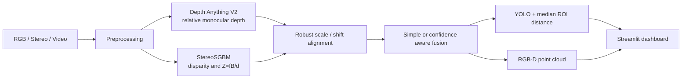

# System architecture

## Modules

| Module | Responsibility |
|---|---|
| `src/depth/monocular.py` | Lazy Hugging Face model loading, device choice, normalized/color depth |
| `src/depth/stereo.py` | SGBM matching, invalid masks, geometric conversion and display |
| `src/fusion/depth_fusion.py` | Valid-overlap alignment and weighted/confidence fusion |
| `src/detection/object_detector.py` | YOLO boxes plus median valid depth per region |
| `src/pointcloud/point_cloud.py` | Pinhole RGB-D projection and PLY write |
| `src/calibration/` | Chessboard intrinsics and calibration configuration output |
| `src/processing/video_processor.py` | Bounded, frame-skipped processing iterator |

## Confidence approach

Stereo confidence is nonzero only at valid positive disparities and is boosted by local Laplacian texture. Monocular confidence is a conservative constant wherever a finite prediction exists. This is intentionally a heuristic, not a calibrated uncertainty estimate. `fuse_depth` normalizes the weighted sum only by available confidence, preserving a monocular estimate in stereo holes.

## Metric status

The UI should communicate one of three states:

1. **Relative depth** — single-view learned estimate.
2. **Approximate metric depth** — SGBM plus user-entered focal length/baseline but no verified rectification/calibration.
3. **Calibrated metric depth** — validated camera intrinsics, baseline, and rectification transforms applied.

Only the third can be described as calibrated metric output.
